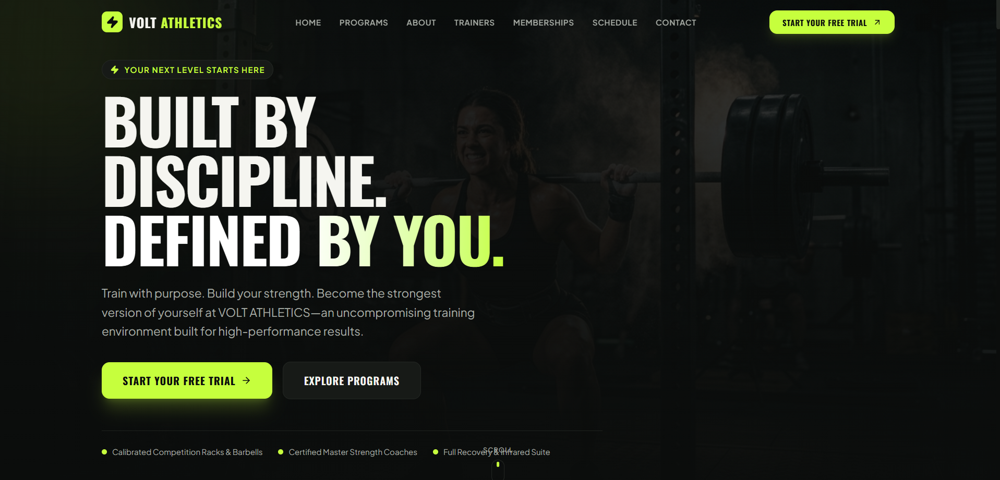

# ⚡ VOLT ATHLETICS — Gym & Fitness Website

**Power Your Potential.**

VOLT ATHLETICS is a modern, responsive gym and fitness website designed to deliver a premium digital experience for fitness enthusiasts. Featuring bold visuals, a sleek interface, and an energetic design, the website showcases training programs, expert trainers, membership plans, and fitness classes.

The project focuses on combining an engaging user interface with responsive layouts and interactive components to create a professional online presence for a fitness brand.

## ✨ Features

- **Modern UI/UX:** Clean layouts, bold typography, and a premium fitness-inspired design.
- **Responsive Design:** Optimized for desktop, tablet, and mobile devices.
- **Training Programs:** Explore strength training, HIIT, personal training, and more.
- **Trainer Profiles:** Showcase fitness trainers and their specializations.
- **Membership Plans:** Present gym membership tiers and their benefits.
- **Class Schedule:** Display weekly workout classes and training sessions.
- **Interactive Elements:** Smooth navigation, hover effects, and engaging animations.
- **Contact & Free Trial:** Provide an interface for inquiries and trial registrations.

*Note: Features will depend on the current implementation. Any forms or booking functionality that is not connected to a backend will operate as a frontend demo.*

## 🛠️ Tech Stack

The project uses the following technologies, where implemented:

- **React** — Component-based UI development.
- **TypeScript** — Type-safe JavaScript development.
- **Vite** — Fast development server and build tooling.
- **Tailwind CSS** — Utility-first styling.
- **Lucide React** — Icons and visual elements.
- **HTML5 & CSS3** — Semantic structure and styling.

## 📸 Preview



## 🚀 Getting Started

Follow these steps to run the project locally.

### Prerequisites

Make sure you have installed:

- [Node.js](https://nodejs.org/)
- npm (included with Node.js)
- Git

### Installation

**1. Clone the repository**

```bash
git clone https://github.com/apoorvnv/volt-athletics.git
```

**2. Navigate to the project directory**

```bash
cd volt-athletics
```

**3. Install dependencies**

```bash
npm install
```

**4. Start the development server**

```bash
npm run dev
```

**5. Open the local URL**

Open the URL displayed in your terminal, usually:

```text
http://localhost:5173
```

## 📬 Live Email Inquiry Setup

The contact inquiry form is pre-configured with **Web3Forms** for instant email forwarding and auto-responder delivery with zero backend maintenance:

1. Obtain a free Access Key at [web3forms.com](https://web3forms.com) (enter your receiving email `apoorvtest0111@gmail.com`).
2. Add your key to your `.env` file locally or in **Vercel Project Settings > Environment Variables**:
   ```env
   VITE_WEB3FORMS_ACCESS_KEY="your-access-key-here"
   VITE_GYM_OWNER_EMAIL="apoorvtest0111@gmail.com"
   ```
3. Alternatively, click the **"Email Settings"** key icon directly on the website footer to save your key in the browser.

*When an inquiry is submitted, the gym owner receives the complete athlete payload, and the applicant receives their confirmation ticket.*

## 📦 Build for Production

To create an optimized production build, run:

```bash
npm run build
```

To preview the production build locally:

```bash
npm run preview
```

## 📁 Project Structure

The project structure may look similar to the following:

```text
volt-athletics/
├── public/
├── src/
│   ├── assets/
│   │   └── images/
│   ├── components/
│   │   └── modals/
│   ├── data/
│   ├── App.tsx
│   ├── main.tsx
│   └── index.css
├── index.html
├── package.json
├── tsconfig.json
├── vite.config.ts
└── README.md
```

*The structure above is illustrative. Adjust it to match the actual files in your repository.*

## 🎨 Design Philosophy

VOLT ATHLETICS combines a bold athletic identity with a clean, modern interface.

The design direction emphasizes:

- Dark backgrounds and high-contrast typography.
- Electric-lime accents for calls to action.
- High-quality fitness imagery.
- Clear content hierarchy and intuitive navigation.
- Smooth interactions and accessible, responsive layouts.

## 🔮 Future Enhancements

- User authentication and member accounts.
- Backend integration for trial registrations and contact forms.
- Real-time class booking and availability.
- Membership subscriptions and payment integration.
- Trainer and workout management dashboard.
- Member progress tracking.
- Deployment with a custom domain.

## 🤝 Contributing

Contributions, suggestions, and feedback are welcome.

1. Fork the repository.
2. Create a feature branch.
3. Commit your changes.
4. Push the branch to your fork.
5. Open a pull request.

## 📄 License

This project is intended for learning and portfolio purposes. Add a `LICENSE` file to specify the terms under which others may use, modify, or distribute the project.

## 👨‍💻 Author

- GitHub: [@apoorvnv](https://github.com/apoorvnv)

---

**VOLT ATHLETICS — Train with purpose. Power your potential.** ⚡
